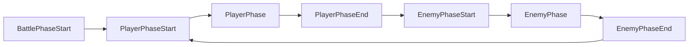
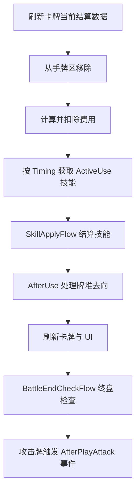
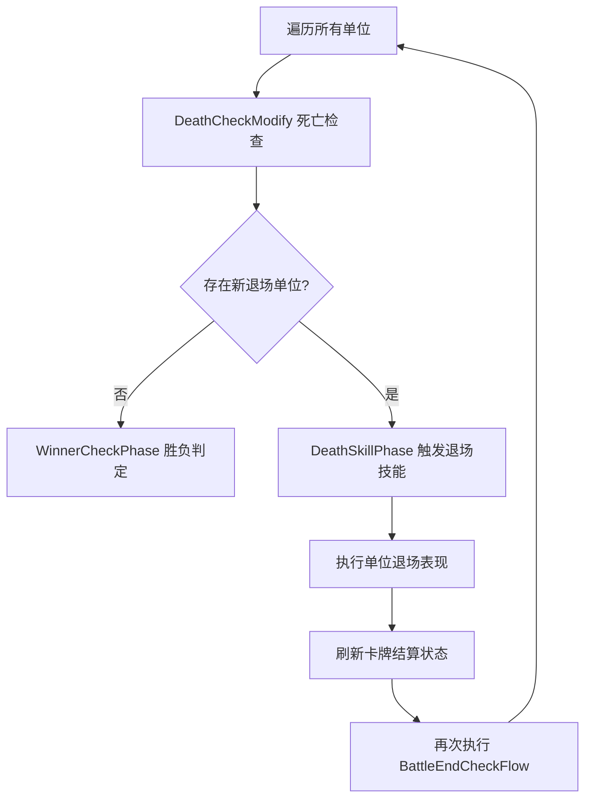
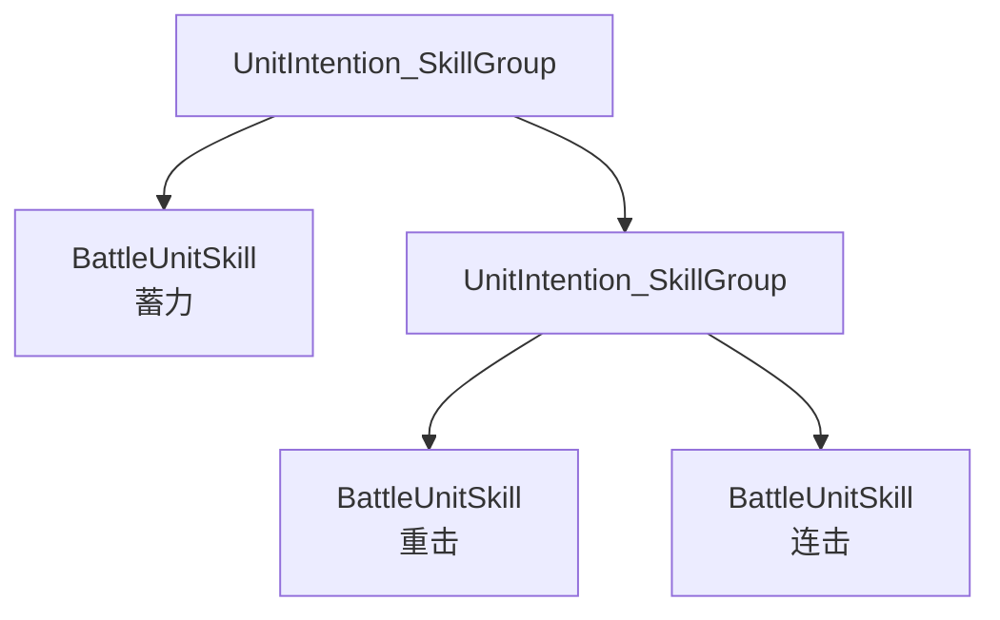
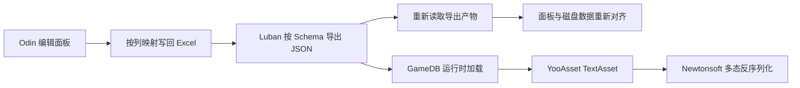

# CardSandBox 技术说明

> 回合制 DBG 卡牌｜Unity / C#｜独立开发  
> 文档版本：2026-10-30  
> 说明范围：战斗结算、阶段流转、修正器事件、动画编排与配置工具链

## 目录

1. [项目概述](#1-项目概述)
2. [核心设计问题](#2-核心设计问题)
3. [回合主循环](#3-回合主循环)
4. [单次出牌与技能结算](#4-单次出牌与技能结算)
5. [终盘检查与连锁退场](#5-终盘检查与连锁退场)
6. [Modifier 事件与配置驱动](#6-modifier-事件与配置驱动)
7. [敌人意图的生成](#7-敌人意图的生成)
8. [动画编排与执行时点](#8-动画编排与执行时点)
9. [配置与卡牌编辑工具链](#9-配置与卡牌编辑工具链)
10. [当前范围与设计取舍](#10-当前范围与设计取舍)
11. [核心代码索引](#11-核心代码索引)

---

## 1. 项目概述

CardSandBox 是一款回合制 DBG 卡牌游戏原型，规则参考《杀戮尖塔》等卡牌游戏。当前版本已经形成连续可玩的战斗闭环，包含：

- 连续 2 个关卡；
- 5 类具有差异化行为模式的敌人；
- 一套围绕力量堆叠构建的卡组；
- 出牌、抽牌、弃牌、消耗、能力牌、修正器、死亡与亡语等战斗机制；
- 卡牌配置与编辑工具链。

本人独立负责规则设计、程序实现、配置工具和问题排查。本文不逐行解释源码，而是说明核心问题、设计方案和关键代码入口。

### 独立完成范围

| 项       | 数据                                |
| ------- | --------------------------------- |
| 自有代码量   | 530 个 C# 文件（不含第三方插件）              |
| 周期与提交   | 18 个月，632 次提交                     |
| 自研编辑器工具 | 剧情节点编辑器（GraphView）、卡牌配置面板、动画创建校验器 |
| 从零实现的系统 | 阶段流转、修改器引擎、连锁退场检查、动画流程队列、存档       |
| 未使用     | ECS、行为树、现成战斗框架                    |

### 演示与代码材料

- 实机演示与卡牌编辑器演示（同一合集）：<https://b23.tv/mhvuBg0>
- 核心代码仓库：<https://github.com/Hono373/SandBox_Card_OpenSource>

### 技术栈

Unity 2022.3 / C# / DOTween / Spine 2D / YooAsset / Odin Inspector / Luban / Newtonsoft.Json

---

## 2. 核心设计问题

卡牌战斗的难点不只是“让一张牌造成伤害”，而是多个规则同时存在时，仍然能够确定它们的执行顺序：

1. 玩家、敌人和回合开始/结束效果需要有明确的阶段边界；
2. 力量、易伤、能力牌和 Buff 需要修正或响应同一次结算；
3. 一个单位退场后，亡语可能继续产生伤害和新的退场单位；
4. 逻辑结算与动画播放的时点不同，不能在动画尚未执行时提前记录结果；
5. 新增卡牌和敌人应尽量通过配置完成，而不是修改战斗主流程。

针对这些问题，当前实现分为三层：

| 层级  | 主要类型                               | 职责                              |
| --- | ---------------------------------- | ------------------------------- |
| 阶段层 | `BattlePhase`                      | 定义回合开始、玩家行动、玩家结束、敌人行动等阶段及默认后继阶段 |
| 流程层 | `BattleFlow`                       | 将一次逻辑操作及其表现组织成可组合的 Sequence 流程  |
| 事件层 | `GameModify` / `ModifierEffect<T>` | 广播结算事件，让已注册的 Modifier 修正数值或响应事件 |

这三层不是完全独立的数据/表现架构，而是通过统一入口明确各自负责的时序：阶段决定“现在处于什么规则区间”，流程决定“事情按什么顺序发生”，事件决定“哪些修正器参与这次结算”。

---

## 3. 回合主循环

下图是各阶段的**默认推进顺序**：



每个 `BattlePhase` 提供默认的 `NextPhase`，但阶段结束时的处理分两种——**只有两处需要决策，其余都是直接推进**：

| 阶段                 | 默认 `NextPhase`     | 结束时的处理                  |
| ------------------ | ------------------ | ----------------------- |
| `BattlePhaseStart` | `PlayerPhaseStart` | `FirstMoveDecide` 判定先后手 |
| `PlayerPhaseStart` | `PlayerPhase`      | `PhaseAdvanceFlow` 直接推进 |
| `PlayerPhase`      | `PlayerPhaseEnd`   | 等玩家点击结束按钮               |
| `PlayerPhaseEnd`   | `EnemyPhaseStart`  | `NextMoveDecide` 判定回合去向 |
| `EnemyPhaseStart`  | `EnemyPhase`       | `PhaseAdvanceFlow`      |
| `EnemyPhase`       | `EnemyPhaseEnd`    | `PhaseAdvanceFlow`      |
| `EnemyPhaseEnd`    | `PlayerPhaseStart` | `PhaseAdvanceFlow`      |
| `BattlePhaseEnd`   | `null`（终局）         | 无后继                     |

### 两个决策点

`FirstMoveDecide` 负责战斗开始时的先后手判定：默认进入 `PlayerPhaseStart`，被偷袭这类规则由 Modifier 往 `nextPhaseWeight` 投入 `EnemyPhaseStart` 改写首个行动方。

```csharp
protected override void CreateResult()
{
    firstPhase = nextPhaseWeight.MaxOrDefault(phase.NextPhase);
}
```

代码入口：`Assets/GameCode/GameManager/GameBattle/DeckBuildBattle/BattlePhase/FirstMoveDecide.cs` 第 27 行。

`NextMoveDecide` 负责玩家回合结束时的去向判定：默认走 `PlayerPhaseEnd.NextPhase`（即 `EnemyPhaseStart`）；需要额外回合时，由 Modifier 往 `nextPhaseWeight` 投入 `PlayerPhaseStart` 覆盖默认值。

```csharp
protected override void CreateResult()
{
    phaseResult = nextPhaseWeight.MaxOrDefault(phase.NextPhase);
}
```

代码入口：同目录 `NextMoveDecide.cs` 第 12 行。

两者都继承 `GameModify`、走 `ModifyAndCreateResult`，规则通过注册 Modifier 参与决策，不需要修改阶段类。要做「本回合结束获得额外一个回合」（如炉石时空之门），接入点就在这里：结算点在玩家回合结束、与敌方无关，把下一步从默认的 `EnemyPhaseStart` 重定向回 `PlayerPhaseStart` 即可。

`nextPhaseWeight` 目前没有任何 Modifier 赋值，所以实际行为等同于按 `NextPhase` 直推。这是有意的留空：额外回合类效果尚未实现，闸门先把改动点留在 `PlayerPhaseEnd` 一处，将来接入时只需注册一个 Modifier，不用动阶段类。

### 推进为什么单独成类

```csharp
public class PhaseAdvanceFlow : BattleFlow
{
    public BattlePhase nextPhase;
    public bool waitLoadingExit;

    protected override void FlowBuild()
    {
        if (waitLoadingExit)
        {
            flow.onComplete += () =>
                GameLoading.GetObj().Exit().onComplete += () => nextPhase.Start();
            return;
        }
        flow.onComplete += () => nextPhase.Start();
    }
}
```

`PhaseAdvanceFlow` 是独立的 `BattleFlow`，`Init()` 会走 `BattleFlow.Init` 的单点闸门：`isGameOver` 时跳过 `FlowBuild`，阶段链自然终止。如果直接在阶段里写 `flow.onComplete += () => NextPhase.Start()`，会绕过这道闸门，战斗结束后仍会继续推进。

代码入口：同目录 `PhaseAdvanceFlow.cs` 第 31 行。

两个入口方法把「什么时候启动下一阶段」收敛到同一处：

- `Start(nextPhase)` —— 流程播完立刻推进，用于五个普通阶段和 `PlayerPhaseEnd`
- `StartAfterLoading(nextPhase)` —— 播完再等遮罩退场，只有 `BattlePhaseStart` 使用

### 一个例外

`PlayerPhase` 不自动推进：它等玩家点击结束按钮，由 `PressPlayerRoundEnd` 直接取 `NextPhase` 启动。当前没有需要改写「玩家主动结束回合」去向的规则，所以这个入口保持直连；若将来出现，改的是 `PressPlayerRoundEnd` 而不是各阶段。

---

## 4. 单次出牌与技能结算

一次出牌由 `BattleCardUsePhaseFlow` 作为根流程组织，主要步骤如下：



核心入口：

```csharp
battleCardModify.Start(card, needSettle);
DeckBuildBattle.Active.deck.GetPile(PileEnum.Hand).Remove(card);
battleCardUseFlow.Start(card, choice);

flow.Join(battleCardUseFlow.flow);
flow.Append(battleEndCheckFlow.Start().flow);
```

代码入口：`Assets/GameCode/GameManager/GameModify/BattleCardUsePhaseFlow.cs` 第 20 行。

### 技能内部结算

`SkillApplyFlow` 负责把一张卡或一个单位技能拆成可执行的效果流程：

1. 根据是否指定目标确定 `targetPool`；
2. 通过 `countRule` 计算技能执行次数；
3. 每次执行重新获取目标列表；
4. 为当前目标创建技能效果副本；
5. 依次处理被动修正、效果计算和效果动画；
6. 多段技能之间串行，同一段内不同目标的表现可以并行；
7. 技能动画结束后，再统一处理受击触发事件。

```csharp
var effect = skill.effect.Create();
var passiveModify = effect.PassiveModify(caster, target, needSettle);
var result = effect.Apply(caster, target, passiveModify);
passiveModify.Settle();
var effectFlow = effect.Start(caster, target, result);
countFlow.Join(effectFlow.flow);
```

代码入口：`Assets/GameCode/GameManager/GameModify/SkillApplyFlow.cs` 第 56 行。

这里没有让所有效果共用一个可变实例，而是对当前目标调用 `Create()`，避免多目标或多段结算时互相覆盖上下文。受击记录先在构建阶段收集，再通过 `AfterTakeDmgFlow` 接到技能序列末尾，使受击被动的表现不会早于伤害动画。

---

## 5. 终盘检查与连锁退场

终盘检查是整套结算中最关键的部分。伤害结算后，不能只对当前目标做一次死亡判断，因为退场和亡语仍可能改变场上状态。



核心实现：

```csharp
if (deathUnits.Count != 0)
{
    foreach (var unit in deathUnits)
    {
        var deathSkillPhase = new DeathSkillPhase().Start(this, unit);
        flow.Join(deathSkillPhase.flow);
    }
    flow.Append(refreshBattleCardGroupFlow.Start(needSettle: false).flow);
    var loop = new BattleEndCheckFlow().Start();
    flow.Append(loop.flow);
}
else
{
    var winnerCheckPhase = new WinnerCheckPhase().Start(this);
    flow.Append(winnerCheckPhase.flow);
}
```

代码入口：`Assets/GameCode/GameManager/GameBattle/DeckBuildBattle/Prefab/BattleCard/interface/BattleEndCheckFlow.cs` 第 14 行。

`DeathCheckModify` 将死亡判断本身也作为可修正事件处理。默认规则是 `hp <= 0` 或处于濒死状态，但 Modifier 可以通过 `skipDeathCheck` 参与判断，为死亡抵抗类规则留下入口。

例如，单位 A 退场时触发亡语，使单位 B 进入濒死状态。B 不会被留到下一次出牌或下一回合才处理，而会在递归终盘检查中继续进入退场流程。直到没有新的退场单位，才进入 `WinnerCheckPhase` 做胜负判定。

这一设计解决的是“结算何时真正结束”的问题：终盘不是固定执行一次，而是持续检查到场上状态稳定。

---

## 6. Modifier 事件与配置驱动

### 事件广播

`GameModifyCenter.Modify()` 对当前注册的 Modifier 做快照遍历，并把事件交给各个 `ModifierEffect`：

```text
GameModify 事件实例
    ↓
GameModifyCenter.Modify()
    ↓
ModifierEffect<T>.Modify()
    ↓
仅当 context 是订阅的事件类型 T 时响应
```

快照遍历避免事件响应过程中增删 Modifier 导致集合遍历失效。`GameModify.Settle()` 将扣层、移除等操作延迟到事件结果被消费之后，进一步分离“读取修正结果”和“修改修正器状态”。

### 通用阶段订阅者

阶段效果不采用“一种 Buff 写一个专用订阅类”的方式，而是由 `PhaseSkill` 统一处理：

```csharp
public override void Modify(Modifier modifier, OnPhaseStartModify context)
{
    if (!Match(modifier, context.phase))
        return;
    context.skillApplyFlows.Add(
        new SkillApplyFlow().Start(skill, modifier.GetOwner(), null, 0, true));
}
```

代码入口：`Assets/GameCode/GameManager/GameModify/Object/PhaseSkill.cs` 第 10 行。

`PhaseSkill` 根据配置的阶段类型匹配战斗开始、玩家开始/结束、敌人开始/结束和死亡等时机，具体执行内容交给配置的 `Skill`。因此，新增一个“回合开始时触发某效果”的 Buff，主要工作是配置效果，而不是新增一套结算流程。

---

## 7. 敌人意图的生成

意图不是一段行为脚本，而是一棵树：`UnitIntention_SkillGroup` 是分支，`BattleUnitSkill` 是叶子。组可以嵌套组，叶子才携带实际招式。



每次刷新意图时，先从配置树 `Create()` 一份运行时副本，避免条件判定污染配置；再拿单位当前状态走一遍：

```csharp
public override BattleUnitSkill GetResult(BattleUnit unit)
{
    return GetResult(ConditionFliter(unit), unit);
}
```

代码入口：`Assets/GameCode/UnitIntention/Base/UnitIntention_SkillGroup.cs` 第 21 行。

### 条件先过滤，权重再随机

`ConditionFliter` 逐个跑子节点的 `fliter.Result(unit)`，全部规则通过才进入候选池。`IntentionCondition` 是 all-must-pass 语义，规则为空视为无限制。

过滤完再按权重抽。权重不是每次线性累加，而是构造期铺成前缀和数轴，选择时二分：

```csharp
// 权重 [70, 25, 4, 1] → 前缀和 [70, 95, 99, 100]
// randomValue ∈ [0, 100) 落在哪个区间就选哪个
public int SelectIndex(int randomValue)
{
    var index = prefixSums.BinarySearch(randomValue);
    return index < 0 ? ~index : index + 1;
}
```

代码入口：`Assets/GameCode/UnitIntention/WeightedRandomSelector.cs` 第 33 行。构造期同时校验负权重与总和为零，非法配置直接抛异常，不会静默退化成均匀分布。

条件本身是可组合的独立类，不是 if-else 堆叠：

| 条件                                     | 语义                           |
| -------------------------------------- | ---------------------------- |
| `ConsecutiveType`                      | 最近 N 次行动全是指定类型，用于「蓄力够次数才放大招」 |
| `NotConsecutiveType`                   | 最近 N 次不全是，用于避免同一招连续使用        |
| `CumulativeType` / `NotCumulativeType` | 累计计数类                        |
| `MateAliveCount`                       | 己方存活数满足比较，用于「有队友才放辅助招」       |

### 意图要稳定：重绘不等于重抽

意图在阶段刷新时算一次，结果存在 `unit.unitSkill` 上，UI 只读它。数值变化（力量、虚弱、易伤）触发的是重绘，不是重算。否则玩家看到的意图会在一个回合内自己跳变。

`RefreshUnitIntentionFlow` 把这条规则写进了代码注释和实现：

```csharp
protected override void FlowBuild()
{
    // 只刷 UI，不重算 unitSkill：这个 flow 被 ModifierAddFlow 复用，用来「按新数值重绘意图」，
    // 若在这里重算会顺手换掉敌人这一轮已经确定的招。要重抽请显式调 RefreshData。
    flow.Join(ui.intentionUI.Refresh(unit));
}
```

代码入口：`Assets/GameCode/GameManager/GameBattle/DeckBuildBattle/BattlePhase/RefreshUnitIntentionFlow.cs` 第 18 行。

要真正重抽必须显式调 `RefreshData(unit)`；需要在播放时点同步刷新（行动后先写入历史再算）则用 `RefreshNow(unit)`。

### 与 Modifier 的边界

意图的**选择过程不经过 Modifier**，只读 `IntentionCondition` 与 `unit.skillHistory`。Modifier 影响的是另外两处：


- 意图数值的显示：`BattleUnitSkill.PreviewIntentionDesc` 在技能副本上依次跑 `ActiveModify` / `PassiveModify`，把力量、虚弱、易伤算进 UI 数字，但不污染用于结算的实例
- 数值变化后的重绘：`ModifierAddFlow` 复用 `RefreshUnitIntentionFlow`，只重绘不重抽

这个边界是有意的：选招依据「AI 想干什么」，不该被玩家施加的临时数值改写；而「这一招打多少」必须随修正实时变化，否则玩家看到的是过期的威胁值。

---

## 8. 动画编排与执行时点

### 根流程与子流程

所有 `BattleFlow` 都使用暂停态的 DOTween Sequence：

- 子流程通过 `Append` / `Join` 表达串行和并行关系；
- `RootBattleFlow` 将根流程交给 `GameAnimFlow`；
- `GameAnimFlow` 保证根流程按队列逐个播放，当前根流程完成后再启动下一个。

这样可以将一次操作内部的并行表现，与多个根流程的播放顺序分开处理。

代码入口：`Assets/GameCode/GameManager/GameSeqFlow/GameAnimFlow.cs` 第 9 行。

### 构建时刻不等于播放时刻

敌人行动组会在构建阶段提前生成多个单位的流程，但后续单位开始播放时，前面的单位可能已经改变了场上状态。因此，某些数据不能在 `FlowBuild()` 中立即写入。

```csharp
flow.AppendCallback(unit.RecordSkillHistory);
```

代码入口：`Assets/GameCode/GameManager/GameBattle/DeckBuildBattle/BattlePhase/UnitActionFlow.cs` 第 19 行。

技能历史必须在单位行动实际播放时记录，而不是在整个行动组构建时提前记录。否则，排在后面的单位即使尚未行动，也会被当成已经使用过对应技能，影响后续意图筛选。

这一处体现了本项目中一个重要的时序原则：**流程依赖可以在构建期确定，但与实际播放结果相关的状态，应在对应播放时点更新。**

---

## 9. 配置与卡牌编辑工具链

卡牌数据的编辑链路为：



编辑器中的“写入 info 并同步表格”按固定顺序执行：

1. 将当前编辑结果映射并写回源 Excel；
2. 调用 Luban 重新导出 JSON；
3. 重新读取 Luban 产物；
4. 让面板重新对齐磁盘数据。

代码入口：`Assets/GameCode/GameManager/GameExcel/InfoCreator.cs` 第 325 行。

运行时由 `GameDB` 通过 YooAsset 加载配置文本，并使用 Newtonsoft.Json 处理多态类型。Luban 导出的短类型名通过自定义 `SerializationBinder` 兼容，配置反序列化错误会关联到当前配置 key，便于定位具体条目。

代码入口：`Assets/GameCode/GameManager/GameExcel/GameDB.cs` 第 21 行。

该工具链的重点不是“用 Excel 存数据”，而是让编辑器、源表格和运行时产物保持一致，并把格式校验交给 Luban 导出环节。编辑器还会检查源 Excel 是否比 JSON 更新，提示配置可能已经过期。

---

## 10. 当前范围与设计取舍

- <u>当前版本聚焦单机回合制战斗与内容配置，不包含网络同步。</u>
- <u>架构围绕卡牌结算建模，没有为了追求通用性引入 ECS 或通用行为树。</u>
- <u>阶段、技能和 Modifier 已经能够覆盖当前卡牌与敌人规则，但仍以本项目需求为边界，不将其包装成通用游戏框架。</u>
- 演示视频用于证明实际运行效果，本文用于说明设计与实现。

---

## 11. 核心代码索引

| 内容       | 类型与方法                                   |
| -------- | --------------------------------------- |
| 战斗流程统一入口 | `BattleFlow.Init()` / `FlowBuild()`     |
| 先后手判定    | `FirstMoveDecide.CreateResult()`        |
| 回合去向判定   | `NextMoveDecide.CreateResult()`         |
| 阶段推进     | `PhaseAdvanceFlow.FlowBuild()`          |
| 单次出牌     | `BattleCardUsePhaseFlow.FlowBuild()`    |
| 技能与多目标结算 | `SkillApplyFlow.FlowBuild()`            |
| 连锁退场     | `BattleEndCheckFlow.FlowBuild()`        |
| 死亡判定     | `DeathCheckModify.CreateResult()`       |
| 阶段技能订阅   | `PhaseSkill.Modify()`                   |
| 根动画流程队列  | `GameAnimFlow.Enqueue()` / `TryStart()` |
| 配置写回与导出  | `InfoCreator.WriteRows()`               |
| 运行时配置读取  | `GameDB.LoadInfoFromText()`             |
